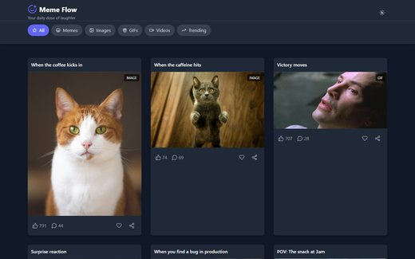
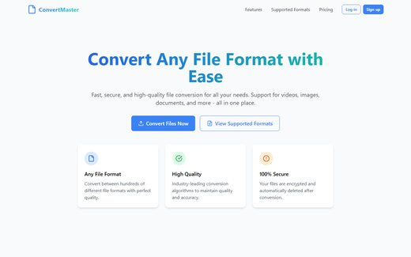
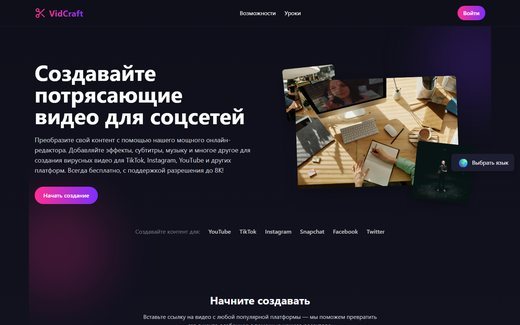
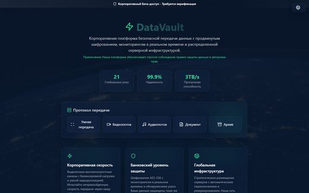
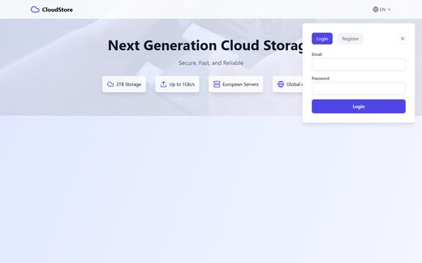
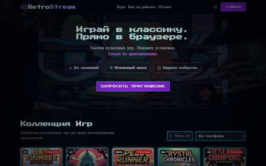
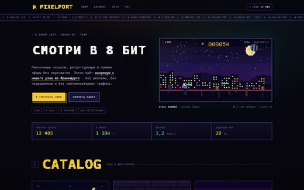
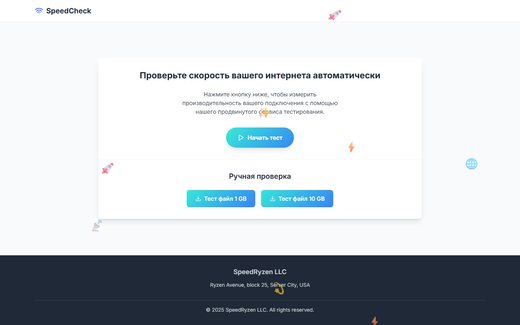
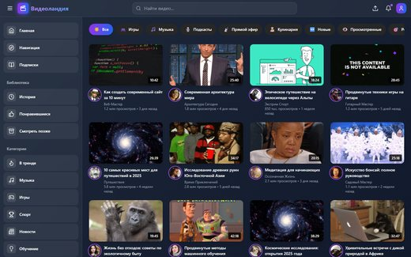

# 3XUI-SNI

Сайт-прикрытие для [3X-UI](https://github.com/MHSanaei/3x-ui) и VLESS Reality.
Nginx с настоящим TLS-сертификатом отдаёт статический сайт на `127.0.0.1:9443`,
а inbound Reality использует ваш домен как SNI. Для клиента и стороннего
наблюдателя это обычный работающий сайт.

```
Клиент ──TLS, SNI=example.com──► 3X-UI :443 (Reality)
                                   │
                                   ▼
                         Nginx 127.0.0.1:9443 ──► /var/www/html
```

Что делает установщик:

- ставит Nginx из официального репозитория `nginx.org` (HTTP/2, TLS 1.2/1.3);
  если репозиторий недоступен, используется версия из дистрибутива;
- копирует выбранный шаблон в `/var/www/html`;
- создаёт конфиг `/etc/nginx/conf.d/main.conf`, слушающий только localhost;
- проверяет конфигурацию и перезапускает Nginx;
- печатает готовые значения для inbound Reality.

Сайт доступен только с самого сервера: порт `9443` не открывается в интернет.

## Требования

- Debian 10–13 или Ubuntu 20.04–24.04, root-доступ;
- доступ в интернет: GitHub (шаблоны) и `nginx.org` (пакеты Nginx);
- установленная панель 3X-UI;
- домен, A-запись которого указывает на сервер (нужна для выпуска сертификата);
- сертификат для этого домена в каталоге `/root/cert/<домен>/` (другой путь
  можно указать через `--cert-dir`).

## Быстрая установка

```bash
bash <(curl -Ls https://raw.githubusercontent.com/KirgizAzur/3XUI-SNI/main/install.sh)
```

Установщик спросит три вещи:

1. **Домен** — например, `example.com` (он же SNI).
2. **Порт Nginx** — по умолчанию `9443`, можно указать свой.
3. **Шаблон** — номер из списка или случайный.

Дальше всё делается автоматически. В конце скрипт покажет параметры для
3X-UI и команду проверки.

### Неинтерактивный режим

```bash
bash install.sh --domain example.com --port 9443 --template converter
bash install.sh --domain example.com --random
```

## Сертификат

Удобнее всего выпустить сертификат прямо в панели 3X-UI:

**Settings → Certificates → Get SSL** → укажите домен.

Файлы появятся в `/root/cert/<домен>/fullchain.pem` и `privkey.pem` — именно их
ожидает установщик. 3X-UI продлевает сертификат автоматически.

Если сертификат лежит в другом месте (например, выдан `certbot`), передайте
путь параметром `--cert-dir /etc/letsencrypt/live/example.com`.

Если сертификата нет, установщик остановится и попросит его выпустить.
Принудительно продолжить можно флагом `--force` — но Nginx не запустится,
пока файлов нет.

## Настройка inbound в 3X-UI

Создайте inbound (или отредактируйте существующий):

| Поле | Значение |
| --- | --- |
| Протокол | `VLESS` |
| Порт | `443` |
| Security | `Reality` |
| Dest / Target | `127.0.0.1:9443` |
| SNI / Server Names | `example.com` (ваш домен) |
| Flow | `xtls-rprx-vision` (по желанию) |
| Fingerprint | `chrome` |

В разных версиях 3X-UI поле `Dest` может называться `Target`, а порт —
отдельным полем `Port`. Смысл один: Reality должен ходить за TLS на локальный
Nginx, а SNI — совпадать с доменом сертификата.

## Проверка

На сервере:

```bash
curl -sI --resolve example.com:9443:127.0.0.1 https://example.com:9443/
```

Ожидаемый ответ — `HTTP/2 200` и заголовки Nginx.

Из браузера: подключитесь к своему inbound и откройте `https://example.com` —
должен открыться выбранный шаблон.

Проверить снаружи напрямую (`https://example.com:9443`) нельзя — порт слушает
только localhost. Это ожидаемое поведение, а не ошибка.

## Параметры установщика

| Параметр | Описание |
| --- | --- |
| `-d`, `--domain <домен>` | домен для SNI |
| `-p`, `--port <порт>` | порт Nginx на localhost (по умолчанию `9443`) |
| `-t`, `--template <имя>` | шаблон сайта |
| `-r`, `--random` | выбрать случайный шаблон |
| `-c`, `--cert-dir <путь>` | каталог сертификата |
| `-l`, `--list` | показать список шаблонов |
| `-u`, `--uninstall` | удалить конфигурацию Nginx |
| `-f`, `--force` | продолжить без сертификата |
| `-h`, `--help` | справка |

Те же значения можно передать переменными окружения `DOMAIN`, `PORT`,
`TEMPLATE`, `CERT_DIR`.

## Шаблоны

| Шаблон | Сайт | Язык | Превью |
| --- | --- | --- | --- |
| `10gag` | лента мемов Meme Flow | EN |  |
| `converter` | конвертер файлов ConvertMaster | EN |  |
| `convertit` | видеоредактор VidCraft | RU |  |
| `downloader` | передача данных DataVault | RU |  |
| `filecloud` | облачное хранилище CloudStore | EN |  |
| `games-site` | ретро-игры RetroStream | RU |  |
| `pixelport` | пиксельное ТВ PIXELPORT | RU |  |
| `speedtest` | тест скорости SpeedCheck | RU |  |
| `youtube-captcha` | видеохостинг «Видеоландия» | RU |  |

Список всегда можно получить командой:

```bash
bash install.sh --list
```

В `pixelport` кнопка «Скачать» на карточке игры отдаёт настоящий файл с сервера.
Установщик создаёт в `/var/www/html/dl/` файлы заявленного веса (640 МБ, 1.4 ГБ
и т. д.) как разреженные: `ls` показывает гигабайты, `du` — килобайты, а
скачивание идёт реальным трафиком из Германии в Россию. Внутри — нули, но
`.torent` начинается с bencode-заголовка, а `.iso` с нулей, как и положено
ISO9660, так что первые байты не выдают подделку.

Расширение переключается одной строкой — `DL.ext` в `index.html`; установщик
кладёт оба файла, `.torent` и `.iso`. Для файла в 1.4 ГБ правдоподобнее `.iso`:
настоящий торрент-файл весит десятки килобайт.

Плеер — обычный `<video>` с роликом `media/pixel-runner.webm` (1280×720, 30 с,
зациклен): настоящий файл, настоящие запросы, живые кнопки. Скрытых панелей,
режимов «демо/сеть» и генераторов трафика в странице нет — они и были главным
следом, по которому видно подделку в DevTools.

## Обновление и смена шаблона

Просто запустите установщик ещё раз — он заново скачает репозиторий и заменит
содержимое `/var/www/html`. Домен, порт и сертификат можно указать те же.

Если каталог `/var/www/html` не создавался этим установщиком (нет файла
`/etc/3xui-sni.conf`), прежнее содержимое будет сохранено в
`/var/www/html.backup.<дата>`.

## Свой шаблон

Добавьте каталог в `templates/` — установщик подхватит его автоматически:

```
templates/my-site/
├── index.html
├── site.webmanifest
├── favicon.ico
├── favicon.svg
├── favicon-96x96.png
├── apple-touch-icon.png
├── web-app-manifest-192x192.png
├── web-app-manifest-512x512.png
└── assets/
    ├── script.js
    └── style.css
```

Требования:

- только статика: HTML, CSS, JS, изображения, шрифты (без PHP и баз данных);
- пути к ресурсам — абсолютные от корня сайта (`/assets/script.js`), потому что
  содержимое каталога копируется в корень `/var/www/html`;
- главная страница — `index.html`.

## Удаление

```bash
bash install.sh --uninstall
```

Удаляются `/etc/nginx/conf.d/main.conf` и `/etc/3xui-sni.conf`, Nginx
перезагружается. Файлы сайта в `/var/www/html` остаются — удалите их вручную,
если они больше не нужны.

## Частые проблемы

| Симптом | Причина | Решение |
| --- | --- | --- |
| `nginx: [emerg] cannot load certificate` | нет файлов сертификата | выпустить сертификат в 3X-UI, повторить запуск |
| `Порт 9443 уже занят` | порт занят другим сервисом | указать другой порт: `--port 9444` |
| `unknown directive "http2"` | старый Nginx | установщик сам выбирает синтаксис; при ручной правке используйте `listen ... ssl http2;` |
| Сайт не открывается через клиент | не совпадает SNI, сертификат или Dest | проверить домен, A-запись, SNI и `127.0.0.1:9443` в inbound |
| `nginx -t` проходит, но сайт не отдаётся | конфиг не включён в `nginx.conf` | проверить `nginx -T \| grep -A5 'server_name example.com'` |
| Шаблон обновился, а браузер показывает старое | кеш браузера | обновить страницу с `Ctrl+F5` |

Полезные команды:

```bash
systemctl status nginx
nginx -t
nginx -T | grep -A10 "server_name example.com"
ss -ltn | grep 9443
tail -f /var/log/nginx/example.com-error.log
```

## Структура репозитория

```
.
├── install.sh                  установщик
├── templates/                  статические сайты
│   ├── 10gag/                  Meme Flow (EN)
│   ├── converter/              ConvertMaster (EN)
│   ├── convertit/              VidCraft (RU)
│   ├── downloader/             DataVault (RU)
│   ├── filecloud/              CloudStore (EN)
│   ├── games-site/             RetroStream (RU)
│   ├── pixelport/              PIXELPORT (RU)
│   ├── speedtest/              SpeedCheck (RU)
│   └── youtube-captcha/        «Видеоландия» (RU)
└── docs/screenshots/           превью шаблонов
```

## Примечания

- Порт `9443` открывать в файрволе не нужно — он слушает только `127.0.0.1`.
- Продление сертификата выполняет 3X-UI; раз в пару месяцев стоит проверять
  `openssl x509 -enddate -noout -in /root/cert/example.com/fullchain.pem`.
- Шаблоны — демонстрационные статические сайты без реальной серверной части.
- Используйте инструмент в рамках законодательства вашей страны.
